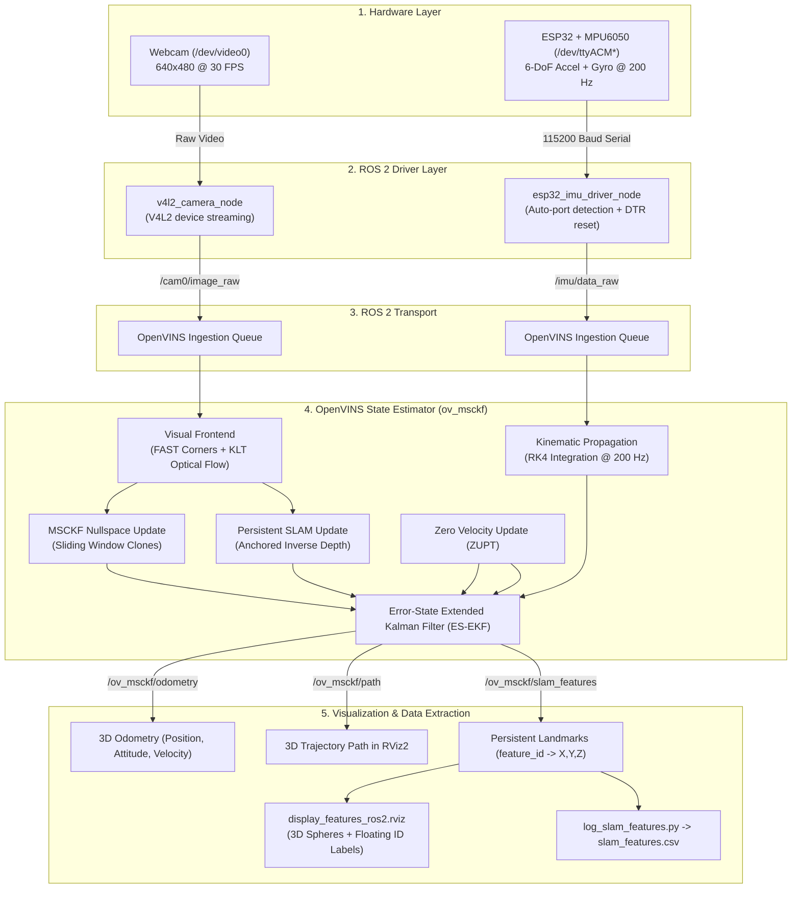
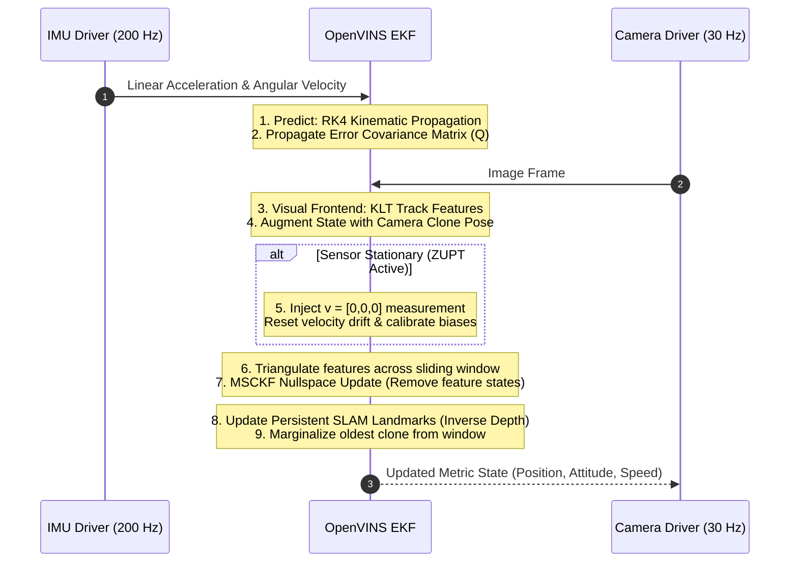
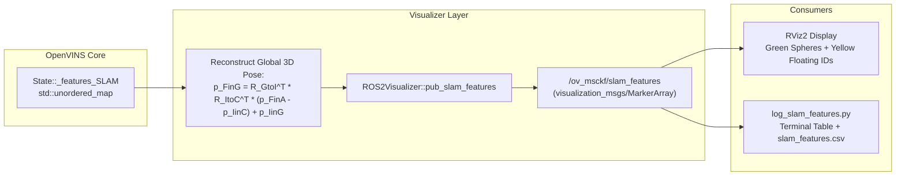

# Visual-Inertial Odometry & 3D Feature Tracking Architecture

This document describes the complete architecture of the Real-Time Visual-Inertial Odometry (VIO) and persistent 3D feature tracking system built on **ROS 2 Humble**, **OpenVINS (`ov_msckf`)**, **ESP32 + MPU6050 IMU**, and a **monocular camera**.

The system estimates the 6-DoF ego-motion (position, attitude, velocity) of the sensor rig without GPS, and extracts metric 3D positions of persistent visual landmarks associated with unique feature IDs (`feature_id -> X, Y, Z`) in the global inertial frame.

---

## 1. High-Level System Architecture



---

## 2. Layer-by-Layer Architectural Breakdown

### 2.1 Hardware Layer

| Component | Interface / Port | Sampling Rate | Role |
| :--- | :--- | :--- | :--- |
| **Monocular Webcam** | `/dev/video0` (UVC) | 30 Hz | Captures 2D perspective bearing rays. Provides visual parallax as the camera translates. |
| **ESP32 + MPU6050** | `/dev/ttyACM*` (CDC-ACM USB) | 200 Hz | Measures specific force ($a - g$) and angular velocity ($\omega$). Senses Earth's gravity vector ($9.81\,\text{m/s}^2$) to establish the **metric scale** (meters). |
| **Mechanical Rigidity** | Rigid physical mounting | $\infty$ | The IMU and camera are rigidly coupled with zero flex. Their spatial offset is represented by the extrinsic transform $T_{cam}^{imu}$. |

---

### 2.2 Driver & Middleware Layer

#### A. `v4l2_camera` Node
* Streams native YUYV frames from `/dev/video0` at 640x480 resolution.
* Converts pixel encoding to standard RGB8 / Mono8 and attaches high-precision ROS timestamps.
* Publishes to `/cam0/image_raw`.

#### B. `esp32_imu_driver` Node
* **Automatic Port Detection:** Automatically searches candidate device paths (`/dev/ttyACM0`, `/dev/ttyACM1`, `/dev/ttyACM2`, `/dev/ttyUSB0`) so Linux serial re-enumeration on hot-reconnect never breaks startup.
* **Auto-Reset Circuit Management:** Pulses DTR and RTS lines (`TIOCMBIC` / `TIOCMBIS`) on initialization to clear the ESP32 hardware reset latch without getting stuck in the ROM bootloader.
* **POSIX Non-Blocking I/O:** Reads raw ASCII lines over serial at 115200 baud, parses 6-DoF accelerometer ($a_x, a_y, a_z$) and gyroscope ($\omega_x, \omega_y, \omega_z$) readings, and publishes `sensor_msgs/msg/Imu` to `/imu/data_raw`.

---

### 2.3 Synchronization & Queueing Mechanism

In Visual-Inertial Odometry, state propagation requires that IMU measurements strictly span the time between consecutive camera exposures.

In `ROS2Visualizer.cpp`:
1. Camera images enter a sorted queue (`camera_queue`).
2. An image is only popped and processed when the latest IMU timestamp is strictly ahead of the camera frame:
   $$\text{timestamp}_{imu} > \text{timestamp}_{cam} + t_{offset}$$
3. This guarantees causal state propagation and prevents Kalman filter divergence.

---

### 2.4 OpenVINS State Estimation Core (`ov_msckf`)

OpenVINS runs a **Type-Based Error-State Extended Kalman Filter (ES-EKF)**.



#### 1. The Dynamic State Vector ($\mathbf{x}$)
$$\mathbf{x} = \begin{bmatrix} \mathbf{x}_{IMU} & \mathbf{x}_{clones} & \mathbf{x}_{SLAM} & \mathbf{x}_{calib} \end{bmatrix}^\top$$

* **Active IMU State ($\mathbf{x}_{IMU}$ - 15 Dimensions):**
  * Orientation: JPL Quaternion $^{G}_{I}\mathbf{q}$ (World-to-IMU rotation)
  * Position: $^{G}\mathbf{p}_{I}$ (3D coordinates in meters)
  * Linear Velocity: $^{G}\mathbf{v}_{I}$ (in $\text{m/s}$)
  * Gyroscope Bias: $\mathbf{b}_g$ (calibrated online)
  * Accelerometer Bias: $\mathbf{b}_a$ (calibrated online)
* **Sliding Window Clones ($\mathbf{x}_{clones}$ - $6 \times N$ Dimensions, $N=11$):**
  * Rolling history of camera poses used for multi-view feature triangulation.
* **Persistent SLAM Landmarks ($\mathbf{x}_{SLAM}$ - $3 \times M$ Dimensions, $M \le 50$):**
  * Visual landmarks maintained directly inside the Kalman state using **Anchored Inverse Depth** ($\rho = 1/d$).
* **Online Calibration Parameters ($\mathbf{x}_{calib}$):**
  * Spatial camera-to-IMU extrinsic transform ($T_C^I$) and time offset ($t_d$).

#### 2. Propagation Step (200 Hz)
* **Mean State:** Integrates non-linear kinematics using **Runge-Kutta 4th Order (RK4)** numerical integration.
* **Covariance Propagation:**
  $$\mathbf{P}_{k+1} = \boldsymbol{\Phi}_k \mathbf{P}_k \boldsymbol{\Phi}_k^\top + \mathbf{Q}_k$$
  where $\mathbf{Q}_k$ is derived from the sensor noise densities (`accelerometer_noise_density` and `gyroscope_noise_density` in `kalibr_imu_chain.yaml`).

#### 3. Measurement Update Step (30 Hz)
* **Visual Frontend:** FAST corner detection identifies salient texture points. KLT optical flow tracks points frame-to-frame.
* **MSCKF Nullspace Projection:** Features that reach the end of the clone window are triangulated. The measurement equation is projected onto the left nullspace of the feature Jacobian, updating all camera poses without adding feature coordinates into the state matrix (keeping computation $O(N^3)$ where $N$ is clone window size).
* **Persistent SLAM Promotion:** Long-tracked features are promoted into $\mathbf{x}_{SLAM}$. When re-observed, they provide direct EKF measurement updates that eliminate long-term drift.
* **Zero Velocity Update (ZUPT):** When visual disparity and IMU acceleration variance drop below stationary thresholds, OpenVINS injects a zero-velocity measurement ($\mathbf{v} = \mathbf{0}$), freezing position drift and re-centering sensor biases.

---

### 2.5 3D Feature Extraction & Visualization Layer

Standard OpenVINS publishes an anonymous point cloud (`/points_slam`) where individual feature identities are discarded. Our architecture exposes a persistent association:
$$\text{feature\_id} \longrightarrow (X, Y, Z)_{\text{global}}$$



#### Coordinate Transformation Math
For anchored features, coordinates are estimated relative to an anchor camera clone. The global position is reconstructed via:
$$p_{FinG} = R_{G \to I_{anchor}}^\top R_{I \to C_{anchor}}^\top \left( p_{FinAnchor} - p_{IinC_{anchor}} \right) + p_{IinG_{anchor}}$$

#### Output Message Structure
Topic: `/ov_msckf/slam_features` (`visualization_msgs/msg/MarkerArray`)
* **Sphere Markers (`ns="slam_features"`):** 3D position $(X, Y, Z)$ in meters, `id = feature_id`.
* **Text Markers (`ns="slam_features_id"`):** Floating 3D text showing the numeric ID above each landmark in RViz.

---

## 3. File & Repository Structure

```text
~/workspace/catkin_ws_ov/
├── ARCHITECTURE.md                  # Complete architectural documentation
├── log_slam_features.py             # Standalone Python script to log feature_id -> XYZ to CSV
│
├── src/
│   ├── esp32_imu_driver/            # Custom IMU Driver Package
│   │   ├── src/
│   │   │   └── esp32_imu_driver.cpp # Auto-port detection, DTR pulse, serial parser
│   │   └── launch/
│   │       ├── esp32_imu.launch.py            # Standalone IMU launch
│   │       ├── full_system.launch.py          # Original full VIO system launch (Untouched)
│   │       └── full_system_features.launch.py # Dedicated launch with Feature ID RViz display
│   │
│   └── open_vins/                   # OpenVINS Core State Estimator
│       ├── config/my_laptop_esp32/
│       │   ├── estimator_config.yaml          # Filter options, ZUPT, feature counts
│       │   ├── kalibr_imu_chain.yaml          # Realistic MPU6050 noise & random walk parameters
│       │   └── kalibr_imucam_chain.yaml       # Camera intrinsics and camera-IMU extrinsics
│       └── ov_msckf/
│           ├── launch/
│           │   ├── display_ros2.rviz          # Standard RViz display (Untouched)
│           │   └── display_features_ros2.rviz # RViz display with MarkerArray Feature IDs
│           └── src/ros/
│               ├── ROS2Visualizer.h           # Declares pub_slam_features
│               └── ROS2Visualizer.cpp         # Computes global XYZ and publishes MarkerArray
```

---

## 4. Operational Guide

### 4.1 Build
Always build single-threaded on resource-constrained systems:
```bash
cd ~/workspace/catkin_ws_ov
colcon build --packages-select ov_msckf esp32_imu_driver --cmake-args -DCMAKE_BUILD_TYPE=Release --parallel-workers 1
```

### 4.2 Run
#### Option A: Run System with Feature ID Visualization (New Setup)
```bash
source ~/workspace/catkin_ws_ov/install/setup.bash
ros2 launch esp32_imu_driver full_system_features.launch.py
```

#### Option B: Run Original System (Untouched Setup)
```bash
source ~/workspace/catkin_ws_ov/install/setup.bash
ros2 launch esp32_imu_driver full_system.launch.py
```

### 4.3 Log Feature IDs & 3D Coordinates to CSV
In a second terminal:
```bash
source ~/workspace/catkin_ws_ov/install/setup.bash
python3 ~/workspace/catkin_ws_ov/log_slam_features.py
```
Output format saved to `slam_features.csv`:
```text
Timestamp      | Feature ID | X (m)     | Y (m)     | Z (m)    
-----------------------------------------------------------------
179134.4210    | 102        | 0.4215    | -0.1732   | 2.8410   
179134.4210    | 117        | 0.8321    | -0.0924   | 3.1042   
```

### 4.4 Clean System Shutdown
To close cleanly:
```bash
# In the launch terminal:
Ctrl + C

# If any process hangs:
killall -9 run_subscribe_msckf v4l2_camera_node esp32_imu_driver rviz2 2>/dev/null
```

---

## 5. Future Drone Roadmap (Target 3D Localization)

This ego-motion pipeline forms the foundation for autonomous drone navigation and target interception:

```mermaid
flowchart LR
    CAM["Camera Feed (/cam0/image_raw)"] --> YOLO["Visual Target Detector (YOLO / ArUco)"]
    CAM --> VIO["OpenVINS (Ego-Motion Estimator)"]
    
    YOLO -->|2D Target Center (u, v)| ASSOC["3D Target Association Node"]
    VIO -->|Drone World Pose (X, Y, Z, Q)| ASSOC
    VIO -->|Persistent 3D Landmarks| ASSOC
    
    ASSOC -->|Target 3D Coordinates wrt Drone| GUIDANCE["Drone Interception / Tracking Controller"]
```

1. **Ego-Motion State:** OpenVINS provides the drone's position, tilt, and velocity relative to the launch pad.
2. **Target Detection:** An external perception node (YOLOv8 or ArUco detector) detects the target in pixel space $(u, v)$.
3. **Triangulation / Association:** By projecting the bearing ray from the drone's current pose and intersecting it with the persistent SLAM landmarks or depth estimation, the system computes:
   $$P_{\text{target}}^{\text{drone}} = \begin{bmatrix} X & Y & Z \end{bmatrix}^\top$$
4. **Guidance:** Enables real-time target tracking and autonomous drone interception without GPS.
